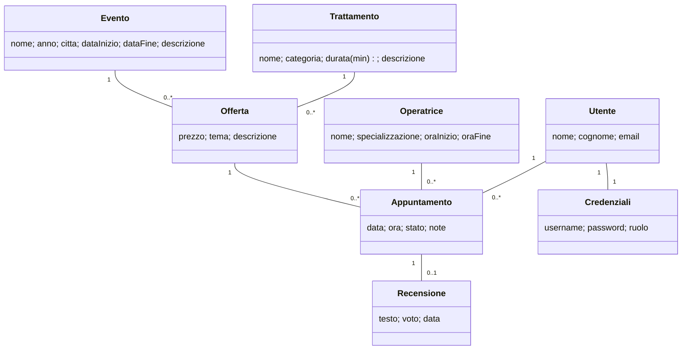

# Siw-nails - Nail Studio

Applicazione web per un centro estetico specializzato in unghie. Il salone organizza **eventi** (es. "Natale in Rosso"):
ogni evento propone alcuni **trattamenti** con un prezzo e un tema propri di quell'evento, e le clienti **prenotano appuntamenti**
con una **operatrice**, nel rispetto del suo orario di lavoro e della sua agenda.

Progetto personale per l'esame di Sistemi Informativi su Web (SIW). Struttura volutamente identica a `Siw-festival`:

| Siw-festival | Siw-nails |
|---|---|
| Festival | Evento |
| Film | Trattamento |
| Interpretazione (Film-Attore, con attributi) | Offerta (Evento-Trattamento, con prezzo e tema) |
| Sala | Operatrice (con orario di lavoro) |
| Proiezione | Appuntamento |
| Recensione | Recensione |

## Tecnologie

Spring Boot, Spring MVC, Spring Data JPA / Hibernate, Spring Security (login con ruoli, password BCrypt),
Thymeleaf, PostgreSQL, Maven.

## Come avviarlo

1. Creare in PostgreSQL (pgAdmin) un database vuoto chiamato `siw-nails`.
2. Controllare username e password in `src/main/resources/application.properties`.
3. Avviare `SiwNailsApplication` (Run As > Spring Boot App) e aprire `http://localhost:8080`.

All'avvio Hibernate crea le tabelle (`ddl-auto=create`) e carica i dati di prova da `src/main/resources/import.sql`
(a ogni avvio il database viene ricreato da zero).

Utenti di prova:

| Username | Password | Ruolo |
|---|---|---|
| `admin` | `admin` | ADMIN |
| `utente1` | `utente1` | USER |
| `utente2` | `utente1` | USER |

## Modello di dominio



Scelte principali:

- **Offerta**: la relazione Evento-Trattamento e' molti-a-molti e ha dati suoi (prezzo e tema cambiano da evento a evento).
  Una semplice `@ManyToMany` non puo' contenerli, quindi la relazione e' una classe con due `@ManyToOne`.
  La coppia (evento, trattamento) e' unica. Il prezzo e' un `BigDecimal` (tipo corretto per i soldi).
- **Appuntamento** collega la cliente, l'offerta (da cui si ricavano evento, trattamento, prezzo e durata) e l'operatrice.
  Evento e trattamento non sono salvati due volte: non possono andare fuori sincrono.
- **Stato** dell'appuntamento: `PRENOTATO`, `COMPLETATO`, `ANNULLATO`.
- **Recensione**: si scrive su un **appuntamento completato**, una sola per appuntamento (colonna `appuntamento_id` unica). Cliente e trattamento si ricavano dall'appuntamento. Non c'e' la lista inversa nell'appuntamento: una `@OneToOne` inversa verrebbe caricata subito per ogni appuntamento (N+1), quindi la recensione si cerca con il repository.
- **Utente / Credenziali** separati: l'anagrafica non viaggia insieme alla password.
- Le liste `@OneToMany` sono `LAZY`; le pagine che le mostrano usano `@EntityGraph` per evitare il problema N+1.

## Casi d'uso

Registrazione e login non sono contati. Attori: **visitatore** (non loggato), **cliente** (ruolo USER), **amministratrice** (ruolo ADMIN).

| # | Caso d'uso | Attore | Tipo | Indirizzo |
|---|---|---|---|---|
| 1 | Prenotare un appuntamento | cliente | **inserimento** | `/prenota` |
| 2 | Spostare/modificare un proprio appuntamento | cliente (o admin) | **aggiornamento** | `/miei-appuntamenti/{id}/edit` |
| 3 | Annullare un appuntamento (stato `ANNULLATO`, resta nello storico) | cliente (o admin) | **cancellazione logica** | `/miei-appuntamenti/{id}/annulla` |
| 4 | Aggiungere un trattamento a un evento (prezzo e tema) | admin | **inserimento** | `/admin/offerte/new` |
| 5 | Togliere un trattamento da un evento (negato se ci sono appuntamenti) | admin | **cancellazione** | `/admin/offerte/{id}/elimina` |
| 6 | Inserire e modificare eventi | admin | inserimento / aggiornamento | `/admin/eventi/new`, `/admin/eventi/{id}/edit` |
| 7 | Inserire e modificare trattamenti | admin | inserimento / aggiornamento | `/admin/trattamenti/new`, `.../{id}/edit` |
| 8 | Inserire e modificare operatrici e orari | admin | inserimento / aggiornamento | `/admin/operatrici/new`, `.../{id}/edit` |
| 9 | Consultare eventi, con trattamenti, prezzi e agenda | tutti | lettura | `/eventi`, `/eventi/{id}` |
| 10 | Consultare i trattamenti e dove sono proposti | tutti | lettura | `/trattamenti`, `/trattamenti/{id}` |
| 11 | Consultare le operatrici e i loro appuntamenti | tutti | lettura | `/operatrici`, `/operatrici/{id}` |
| 12 | Consultare l'agenda e il dettaglio di un appuntamento | tutti | lettura | `/appuntamenti`, `/appuntamenti/{id}` |
| 13 | Consultare i propri appuntamenti | cliente | lettura | `/miei-appuntamenti` |
| 14 | Scrivere, modificare ed eliminare la recensione di un proprio appuntamento completato (voto 1-5, una per appuntamento) | cliente | inserimento / aggiornamento / cancellazione | `/recensioni/appuntamento/{id}/new`, `/recensioni/{id}/edit` |
| 15 | Consultare le recensioni di un appuntamento e, nella pagina del trattamento, tutte le sue recensioni con voto medio | tutti | lettura | `/appuntamenti/{id}`, `/trattamenti/{id}` |

### Regole di prenotazione (casi 1 e 2)

Una prenotazione e' accettata solo se:

1. la data non e' passata;
2. la data cade nel periodo dell'evento a cui appartiene l'offerta scelta;
3. l'appuntamento (dall'ora scelta, per la durata del trattamento) sta dentro l'orario di lavoro dell'operatrice;
4. l'operatrice e' libera: nessun altro appuntamento non annullato si sovrappone (intervalli `[inizio, inizio+durata)`).

La prenotazione e lo spostamento sono operazioni atomiche (`@Transactional`) con isolamento `SERIALIZABLE`, per evitare che due
clienti prenotino la stessa operatrice nello stesso momento (la seconda transazione fallisce e puo' riprovare).
Un appuntamento puo' essere spostato o annullato solo dalla cliente che l'ha preso (o da un admin) e solo se e' ancora `PRENOTATO`.

## Struttura del codice

```
controller/   pagine pubbliche, area admin (/admin/**), area cliente, gestione errori
service/      logica di business e transazioni
repository/   interfacce Spring Data (query derivate, @EntityGraph)
model/        entita' JPA
dto/          oggetti dei moduli (PrenotazioneForm, OffertaForm)
exception/    eccezioni di dominio (NotFound, PrenotazioneNonValida, OperazioneNonConsentita)
configuration/ Spring Security
```

## Stato del progetto

Implementato: modello, area pubblica, login/registrazione, area admin, prenotazione con spostamento e annullamento, recensioni degli appuntamenti completati, pagine di errore 403/404/500.
Non ancora implementato: API REST e frontend React, CSS.
